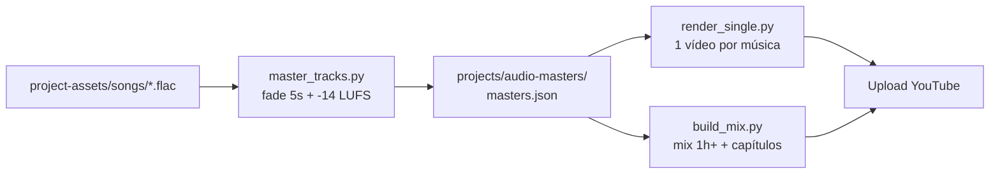

# Music Channel — Skill base do canal

Skill padrão para produção automatizada de canais de música no YouTube.
Projetada para ser agnóstica a gênero musical (funk, lofi, synthwave, rock, etc.) e facilmente reutilizável/forkável.

O canal opera com dois formatos principais:

| Formato | O que é | Skill |
|---|---|---|
| **Single** | 1 música = 1 vídeo (duração da música) | [`music-single-video`](../music-single-video/SKILL.md) |
| **Mix 1h+** | Todas as músicas concatenadas, com capítulos | [`music-mix-compilation`](../music-mix-compilation/SKILL.md) |

Pré-requisito comum de ambos: **masterização** → [`music-audio-mastering`](../music-audio-mastering/SKILL.md).

## Fluxo obrigatório

1. **Nunca** use os arquivos de áudio brutos de `project-assets/songs/` direto num vídeo.
   Sempre use os masters de `projects/audio-masters/assets/audio/`.
2. Masterize uma vez; re-masterize só se a fonte mudar (o script pula o que já
   está atualizado).
3. Inspecione o resultado antes de publicar (ver QA em cada skill).

## Pré-requisitos do ambiente

- `ffmpeg` + `ffprobe`: `sudo apt update && sudo apt install -y ffmpeg fonts-dejavu-core`
- Python 3.9+ (apenas stdlib — zero dependências externas).

## Scripts (compartilhados pelas skills)

Localizados em [`scripts/`](scripts/), saídas sempre sob `projects/` (gitignored):

| Script | Função |
|---|---|
| [`common.py`](scripts/common.py) | Caminhos, wrappers ffprobe/ffmpeg, loudness, detecção de final abrupto, loop visual |
| [`master_tracks.py`](scripts/master_tracks.py) | Fade-out nos últimos 5 s + normalização + manifesto |
| [`render_single.py`](scripts/render_single.py) | Vídeo individual de uma música |
| [`build_mix.py`](scripts/build_mix.py) | Mix 1h+ com capítulos |

Execute a partir da raiz do repo:
`python3 .agents/skills/music-channel/scripts/<script>.py --help`

## Inventário de assets

### Músicas — `project-assets/songs/`
Padrão de nomenclatura suportado: `Artista - Título - [@tag].ext` ou `Artista - Título.ext`

- `<Título>` → título no vídeo e capítulo; slug = título em kebab-case.
- `<tag>` → marcador de estilo/instrumento (opcional). Pode ser usado para selecionar clipes e playlists.

### Clipes — `project-assets/videos/`
Clipes visuais ou imagens estáticas. O pipeline ajusta automaticamente qualquer proporção (ex: vertical, 4:3, etc.) para **16:9** com fundo desfocado estético.

## Padrões técnicos do canal (YouTube)

| Item | Valor |
|---|---|
| Container | MP4, `-movflags +faststart` |
| Vídeo | H.264 High, 1920×1080, 30 fps, `yuv420p`, CRF 18, GOP 2 s |
| Áudio | AAC-LC 320 kbps, 48 kHz, estéreo |
| Loudness | −14 LUFS integrado, true-peak ≤ −1 dBTP |
| Fade-out | 5 s nas faixas com final abrupto (detecção automática por RMS) |
| Aspect ratio diferente | Fundo desfocado + clipe centralizado |

## Customização para novos canais (Forks)

Ao clonar este repositório para outro canal:
1. Defina a variável de ambiente opcional `CHANNEL_NAME="Nome Do Canal"` ou passe `--subtitle` nos comandos.
2. Coloque as músicas novas em `project-assets/songs/` e os vídeos em `project-assets/videos/`.
3. Rode `master_tracks.py` para gerar a base de áudio masterizada.
