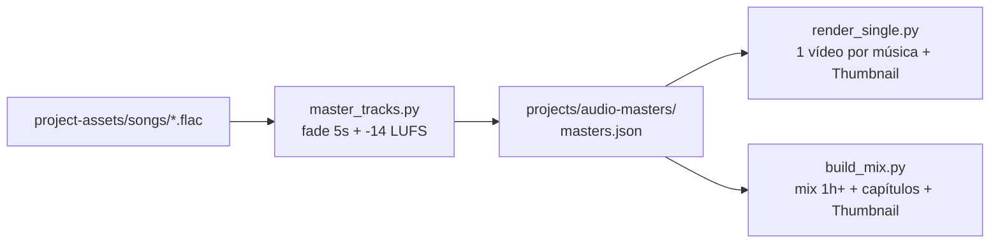

# Como Usar — Automação de Canal de Música para YouTube

Pipeline modular e automatizado para produção de canais de música no YouTube. Projetado para ser agnóstico a gênero musical, permitindo forks imediatos para novos canais/estilos.

---

## 📋 Sumário
1. [Pré-requisitos do Sistema](#-pré-requisitos-do-sistema)
2. [Estrutura de Pastas](#-estrutura-de-pastas)
3. [Fluxo de Trabalho](#-fluxo-de-trabalho)
4. [Passo 1: Masterização de Áudio](#1-masterização-de-áudio-fade-out--lufs)
5. [Passo 2: Vídeo Individual (Single)](#2-vídeo-individual-single-1-música)
6. [Passo 3: Mix Longo (1h+) com Capítulos](#3-mix-longo-1h-com-capítulos)
7. [Como Fazer Fork para Novos Canais](#-como-fazer-fork-para-novos-canais)
8. [Configurações do Canal](#-configurações-do-canal)

---

## ⚙️ Pré-requisitos do Sistema

Instale o `ffmpeg` e fontes TrueType padrão no seu Linux/Debian/Ubuntu:

```bash
sudo apt update && sudo apt install -y ffmpeg fonts-dejavu-core
```

*Python 3.9+ com bibliotecas padrão (sem necessidade de instalar pacotes via pip).*

---

## 📂 Estrutura de Pastas

```text
├── project-assets/
│   ├── songs/        # Coloque aqui as músicas (.flac, .mp3, .wav)
│   └── videos/       # Coloque aqui os clipes de vídeo (.mp4) ou imagens (.jpg, .png)
├── .agents/skills/
│   ├── music-channel/              # Ponto de entrada e scripts centrais
│   │   └── scripts/
│   │       ├── common.py           # Utilitários compartilhados (ffmpeg, filtros, metadados)
│   │       ├── master_tracks.py    # Masterização, fade e loudness
│   │       ├── render_single.py    # Renderizador de singles + geração de thumbnail
│   │       ├── build_mix.py        # Compilador de mix longo + geração de thumbnail
│   │       └── thumbnail_generator.py # Gerador de thumbnails 1280x720 de alto CTR
│   ├── music-audio-mastering/      # Skill de masterização
│   ├── music-single-video/         # Skill de singles
│   └── music-mix-compilation/      # Skill de mixes
└── projects/                       # (Gitignored) Onde ficam todos os renders e saídas
    ├── audio-masters/              # Músicas tratadas e manifesto masters.json
    ├── single-<slug>/renders/      # Vídeos individuais (.mp4) e Thumbnails (<slug>-thumb.jpg)
    └── mix-<data>/renders/         # Vídeos longos de 1h+ e Thumbnails (-thumb.jpg)
```

---

## 🔄 Fluxo de Trabalho



---

## 1. Masterização de Áudio (Fade-out + LUFS)

Detecta automaticamente se os últimos 0.5s contêm som alto ("corte seco/abrupto") e aplica fade-out gradual de 5 segundos. Normaliza para o padrão oficial do YouTube (**-14 LUFS**, pico máx -1 dBTP).

Defina o atalho para a pasta de scripts no terminal:
```bash
S=.agents/skills/music-channel/scripts
```

### Análise prévia (não grava arquivos):
```bash
python3 $S/master_tracks.py --dry-run
```

### Executar a masterização real:
```bash
python3 $S/master_tracks.py
```

#### Opções úteis:
- `--fade-policy all`: Força fade-out de 5s em absolutamente todas as faixas (o padrão é `auto`, que atua apenas nas faixas com final abrupto).
- `--fade 7`: Altera a duração do fade para 7 segundos (padrão é 5s).
- `--only "titulo"`: Processa apenas uma música específica.
- `--force`: Força reprocessamento mesmo se o master já existir.

**Saída gerada:**
- Áudios masterizados em `projects/audio-masters/assets/audio/<slug>.flac`
- Relatório e metadados em `projects/audio-masters/artifacts/masters.json`

---

## 2. Vídeo Individual (Single: 1 Música)

Cria o vídeo individual da música em 1080p 16:9. Se o clipe original for vertical ou de outra proporção, ele aplica automaticamente o efeito de fundo desfocado com primeiro plano centralizado (sem esticar).

```bash
S=.agents/skills/music-channel/scripts

python3 $S/render_single.py \
  --song "slap-attack" \
  --clips project-assets/videos/meu_clipe.mp4
```

#### Múltiplos clipes no loop ou imagens:
```bash
python3 $S/render_single.py \
  --song "slap-attack" \
  --clips project-assets/videos/clipe1.mp4 project-assets/videos/clipe2.mp4
```

#### Opções úteis:
- `--title "Título Customizado"`: Altera o texto principal do card animado (padrão é o título da música).
- `--subtitle "Nome do Canal"`: Texto secundário do card.
- `--no-title`: Remove o card de título no início.
- `--title-seconds 8`: Duração de exibição do card animado (padrão 8s).

**Saída gerada:**
- Vídeo final em `projects/single-<slug>/renders/<slug>.mp4`

---

## 3. Mix Longo (1h+) com Capítulos

Junta todas as músicas masterizadas em um vídeo contínuo com chapters automáticos prontos para colar na descrição do YouTube.

*Destaque: O mix usa a técnica de stream copy (`-c:v copy`) no loop visual repetido, tornando a renderização do vídeo de mais de 1 hora extremamente rápida, sem gastar horas de processamento de CPU.*

### Simular o mix (ordem das faixas e capítulos sem renderizar):
```bash
S=.agents/skills/music-channel/scripts

python3 $S/build_mix.py --dry-run --order shuffle --seed 42
```

### Renderizar o mix definitivo:
```bash
python3 $S/build_mix.py --order shuffle --seed 42
```

#### Opções úteis:
- `--order shuffle`: Ordem aleatória das faixas (use `--seed X` para reproduzir a mesma ordem).
- `--order catalog`: Ordem alfabética das faixas.
- `--order file --order-file minha_lista.txt`: Define a ordem exata das faixas (1 slug por linha).
- `--gap 1.5`: Silêncio de 1.5s entre as músicas (padrão 1.0s).
- `--crossfade 3.0`: Aplica transição suave sobreposta de 3 segundos entre as faixas (estilo DJ set).
- `--min-duration 3600`: Define a duração mínima em segundos (padrão 3660s = ~1h01m). Se a lista de músicas for menor, o script avisa para evitar que você suba um vídeo curto prometendo 1 hora.

**Saída gerada:**
- Vídeo completo em `projects/mix-<data>/renders/mix-<data>.mp4`
- Capítulos prontos para copiar na descrição do YouTube em `projects/mix-<data>/artifacts/chapters.txt`
- Thumbnail do Mix em `projects/mix-<data>/renders/mix-<data>-thumb.jpg`

---

## 4. Upload Automático no YouTube com SEO e Thumbnails

Script completo para publicação direta via YouTube Data API v3 com otimização algorítmica:
- Títulos de alta taxa de clique (CTR) e créditos da faixa
- Descrições ricas com capítulos automáticos injetados
- Tags musicais e categoria Música (ID 10)
- Envio automático da Thumbnail personalizada (`-thumb.jpg`)

### Configuração Inicial (Apenas 1 vez):
1. No [Google Cloud Console](https://console.cloud.google.com/apis/credentials), crie um ID de Cliente OAuth (tipo Desktop App) com a **YouTube Data API v3** ativada.
2. Salve o arquivo JSON na raiz do repositório como `client_secret.json`.

### Comandos de Upload:

```bash
S=.agents/skills/music-channel/scripts

# 1. Enviar um Single específico:
python3 $S/youtube_uploader.py --song "rubber-people" --privacy private

# 2. Enviar o Mix de 1h+ com capítulos na descrição e thumbnail:
python3 $S/youtube_uploader.py --mix "funky-destiny-1hour-bass-mix" --privacy private

# 3. Enviar todos os 24 singles em lote:
python3 $S/youtube_uploader.py --all-singles --privacy private
```

*Nota: Por padrão, o parâmetro `--privacy` usa `private` (privado) para que você possa conferir no YouTube Studio antes de publicar. Você também pode passar `--privacy unlisted` (não-listado) ou `--privacy public` (público).*

---

## 🚀 Como Fazer Fork para Novos Canais

Quando você for criar um novo canal (ex: Lofi, Synthwave, Rock, etc.):

1. **Faça o fork / clone deste repositório** para o novo projeto.
2. **Substitua os arquivos** em `project-assets/`:
   - Coloque as novas músicas em `project-assets/songs/`
   - Coloque os novos vídeos/imagens em `project-assets/videos/`
3. **Execute o pipeline**:
   ```bash
   S=.agents/skills/music-channel/scripts
   python3 $S/master_tracks.py
   python3 $S/build_mix.py --order shuffle
   ```
Pronto! Nenhum arquivo de código precisa ser alterado.

---

## 🏷️ Configurações do Canal

Você pode configurar o nome exibido nos vídeos através de:

- **Variável de Ambiente:**
  ```bash
  export CHANNEL_NAME="Meu Novo Canal"
  ```
- **Ou passando nos argumentos:**
  ```bash
  --subtitle "Meu Novo Canal"
  ```
